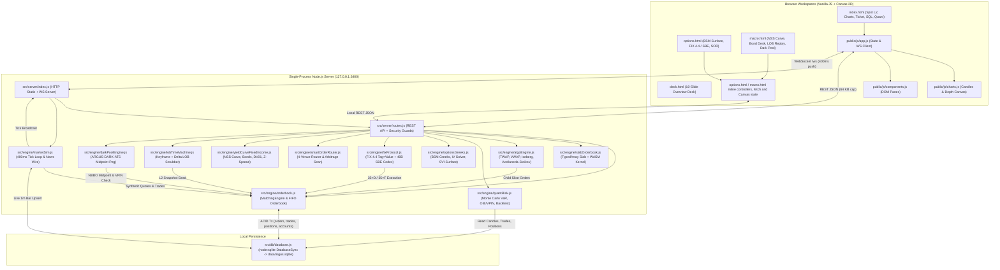
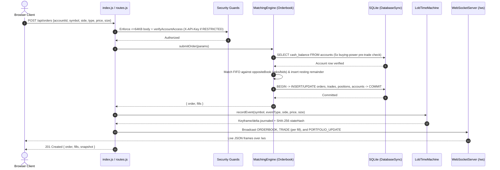

# Argus Terminal — Architecture

Crosscheck: 2026-11-08 WIB. The repository-local offline checks completed with exit code 0 in an interpreter/environment containing the declared dependencies. Hardware, live providers, deployment and unexecuted CI platforms are separate evidence boundaries.

## 1. Overview

**Argus Terminal** is an educational, local-only simulation of a Bloomberg-style multi-pane trading and quantitative analysis terminal: a `<GO>` command bar, a simulated limit order book with price-time priority (FIFO) matching, Canvas 2D candlestick and depth charts, a trades tape, a simulated news wire, options volatility surfaces, FIX 4.4 / binary SBE wire codecs, Nelson-Siegel-Svensson yield curves, deterministic order-book replay, and a read-only SQL console over a local SQLite database.

- All market data, news, venues, and accounts are **simulated**. Nothing connects to a real exchange or broker. It is not financial software and is not affiliated with any exchange, data vendor, or firm.
- Single Node.js process, no build step. Runtime dependencies: Node's built-in `node:sqlite` (`DatabaseSync`) and one npm package, `ws`.
- The HTTP server binds to `127.0.0.1` (port `3400` by default, or `PORT`).

## 2. System Context & Data Flow (`graph TD`)



## 3. Order Execution & Broadcast Pipeline (`sequenceDiagram`)



## 4. Directory Structure & Complete Module Breakdown

```text
argus-terminal/
├── package.json, LICENSE, README.md, ROADMAP.md
├── ARCHITECTURE.md, BENCHMARK_REPORT.md, SECURITY_AUDIT_REPORT.md, DEVTOOLS_AUDIT_REPORT.md
├── data/
│   └── argus.sqlite                  # Auto-created SQLite database (git-ignored)
├── src/
│   ├── db/
│   │   └── database.js               # Schema, deterministic seed data (instruments, demo accounts, positions, candles)
│   ├── engine/
│   │   ├── orderbook.js              # Orderbook + MatchingEngine: FIFO limit/market matching, SQLite persistence, 5x buying-power check
│   │   ├── slabOrderbook.js          # TypedArray "slab" order book with a tiny hand-written WASM helper (benchmark / telemetry)
│   │   ├── marketSim.js              # Simulated price path, synthetic liquidity and trades, news wire
│   │   ├── quantRisk.js              # Monte Carlo VaR/CVaR, order-flow heuristics (OBI, VPIN-style proxy), backtester, rule-based copilot
│   │   ├── algoEngine.js             # Simulated execution algos: TWAP, VWAP, ICEBERG, and an Avellaneda-Stoikov-style quoting schedule
│   │   ├── optionsGreeks.js          # Black-Scholes-Merton pricing, Greeks, implied-vol solver, SVI-style vol surface
│   │   ├── fixProtocol.js            # FIX 4.4 tag=value encode/parse (BodyLength, CheckSum) + a 40-byte binary codec inspired by SBE
│   │   ├── smartOrderRouter.js       # Order routing and arbitrage scan across 4 simulated venues
│   │   ├── yieldCurveFixedIncome.js  # Nelson-Siegel-Svensson (NSS) yield curve, bond dirty/clean pricing, YTM, DV01, convexity, Z-spread
│   │   ├── lobTimeMachine.js         # Keyframe + delta event-sourced LOB replay scrubber with SHA-256 state verification
│   │   └── darkPoolEngine.js         # Simulated midpoint-peg dark pool (ARGUS-DARK-ATS) with minimum acceptable quantity & VPIN check
│   └── server/
│       ├── routes.js                 # REST API handlers + input validation / security guards
│       └── index.js                  # Static file server + REST + WebSocket broadcaster
├── public/
│   ├── index.html                    # Main terminal workspace (/)
│   ├── options.html                  # Options chain, 3D vol surface, FIX inspector, SOR/arbitrage panes (/options.html)
│   ├── macro.html                    # NSS yield curve, bond desk, LOB replay time-machine, dark pool ATS (/macro.html)
│   ├── deck.html                     # 10-slide project overview deck (/deck.html)
│   ├── css/terminal.css
│   └── js/                           # app.js (orchestration, WebSocket client), charts.js (Canvas 2D), components.js (DOM renderers)
├── benchmarks/
│   ├── matching_bench.js             # Matching-engine 5-mode ablation microbenchmark (see BENCHMARK_REPORT.md)
│   └── results/latest.json           # Recorded benchmark output
├── research/                         # AI-assisted study notes (background theory vs. what is implemented)
└── tests/                            # Plain-Node + node:test suites (zero external test runner dependencies)
```

### Module Responsibilities

| Module | Layer | Primary Responsibilities |
| :--- | :--- | :--- |
| `src/db/database.js` | Persistence | Initializes `DatabaseSync` (`WAL` mode on disk or `:memory:`), creates `instruments`, `accounts`, `positions`, `orders`, `trades`, `candles_1m` tables, and deterministically seeds 6 instruments, 3 accounts, initial positions, and 180 historical 1-minute OHLCV bars per symbol. |
| `src/engine/orderbook.js` | Core Matching | `Orderbook` (per-symbol FIFO `bids`/`asks` ladders, 5x `cash_balance` pre-trade margin check, synthetic liquidity replenishment, atomic SQLite position/cash settlement including long/short flips) and `MatchingEngine` (multi-symbol registry + cancel fallback). |
| `src/engine/slabOrderbook.js` | Telemetry / Bench | `SlabOrderbook` storing orders in pre-allocated `Float64Array`/`Int32Array`/`Uint8Array` arenas with intrusive doubly-linked FIFO queues, `idToSlot` + `overflowIdMap` $O(1)$ cancel, a 64-slot object ring pool, and a 94-byte inline WebAssembly module (`priceCrosses`, `minInt`, `calcNotionalCents`). |
| `src/engine/marketSim.js` | Simulation | Runs a `400 ms` `setInterval` loop generating mean-reverting/jump-diffusion price ticks, synthetic maker quotes/taker prints, live 1m candle updates, and periodic macro/crypto news wire items. |
| `src/engine/algoEngine.js` | Execution Algos | `AlgoExecutionEngine` scheduling child orders for `TWAP`, U-shaped volume-profile `VWAP`, `ICEBERG` peak-reload slices, and `AVELLANEDA_STOIKOV` inventory-skewed reservation quotes, tracking implementation shortfall (arrival slippage in bps). |
| `src/engine/quantRisk.js` | Risk & Alpha | Computes parametric & Cholesky-correlated Monte Carlo 95%/99% VaR and CVaR (Expected Shortfall), Order Book Imbalance (`OBI`), roll/trade-imbalance `VPIN` toxicity proxy, SMA/RSI/mean-reversion historical backtests, and rule-based copilot commentary. |
| `src/engine/optionsGreeks.js` | Derivatives | Black-Scholes-Merton European option pricing, analytical 1st/2nd-order Greeks ($\Delta, \Gamma, \Theta, \mathcal{V}, \rho$, Vanna, Volga), hybrid Newton-Raphson + bisection Implied Volatility solver, and SVI-parameterized 3D volatility surface generation. |
| `src/engine/fixProtocol.js` | Wire Protocols | Stateful `FixProtocolEngine` encoding/parsing FIX 4.4 (`8=FIX.4.4`, `9=BodyLength`, `10=CheckSum`, SOH `\x01` or `\|` display delimiter), executing `35=D` (`NewOrderSingle`) and `35=F` (`OrderCancelRequest`) into `35=8` (`ExecutionReport`), plus a fixed 40-byte little-endian binary SBE codec. |
| `src/engine/smartOrderRouter.js` | Routing | Simulates fragmented liquidity across 4 synthetic venues with distinct maker/taker fee tiers and latency profiles, optimizing child allocation by net effective price and scanning cross-venue locked/crossed arbitrage opportunities. |
| `src/engine/yieldCurveFixedIncome.js` | Macro / Rates | Evaluates and calibrates 6-parameter Nelson-Siegel-Svensson (NSS) spot/forward yield curves across 4 macro regimes, prices fixed-coupon bonds (clean/dirty price, accrued interest, Macaulay/Modified duration, DV01, convexity), and solves YTM and Z-spread via root-finding. |
| `src/engine/lobTimeMachine.js` | Event Replay | `LobTimeMachine` maintaining per-symbol bounded delta journals with periodic L2 keyframes (every 10 events), reconstructing historical book states via `seekToSequence` / `seekToTimestamp`, and verifying replay determinism with truncated SHA-256 ladder hashes. |
| `src/engine/darkPoolEngine.js` | Off-Exchange ATS | `DarkPoolEngine` (`ARGUS-DARK-ATS`) crossing institutional block orders at lit NBBO midpoint or session VWAP while enforcing Minimum Acceptable Quantity (`minQty`) anti-pinging rules and VPIN/spread toxicity shields. |
| `src/server/routes.js` | API & Security | Dispatches all `/api/*` endpoints, enforces a 64 KB JSON body cap, `X-API-Key` authentication on `RESTRICTED` accounts (`ACC-VAULT-99`), read-only single-statement `SELECT` validation blocking `accounts`/`api_secret`, and SSRF hostname filtering on `/api/webhooks/test`. |
| `src/server/index.js` | Server Host | Bootstraps `createArgusServer`, serves static assets from `public/` with normalized path-prefix checks, attaches `/ws` `WebSocketServer`, wires `MarketSimulator` and `AlgoExecutionEngine` lifecycle hooks, and handles graceful shutdown. |
| `public/js/{app,charts,components}.js` | Frontend UI | `app.js` manages client state, `<GO>` command routing, REST calls, and WebSocket auto-reconnect; `charts.js` renders hi-DPI Canvas 2D candlesticks, volume bars, and cumulative L2 depth curves; `components.js` updates DOM tables for orderbook, tape, portfolio, news, and analytics. |

Simulated venue names in `smartOrderRouter.js` borrow the shape of real venue names for flavour; the fees and latencies attached to them are made-up demo parameters.

## 5. State Management

Argus Terminal partitions state across three synchronized layers:

1. **Authoritative Relational State (`node:sqlite` `DatabaseSync`)**:
   - Stored on disk at `data/argus.sqlite` (`PRAGMA journal_mode = WAL; PRAGMA synchronous = NORMAL;`) during normal execution, or isolated in `:memory:` when `createArgusServer({ dbMemory: true })` / `ARGUS_DB_MEMORY=1` is used in tests.
   - Six tables: `instruments` (static contract specs), `accounts` (`cash_balance`, `margin_used`, `tier`, `api_secret`), `positions` (`(account_id, symbol)` PK with `qty`, `avg_entry_price`, `realized_pnl`), `orders` (resting and terminal user orders), `trades` (immutable fill ledger), and `candles_1m` (`(symbol, bucket_ts)` PK).
   - Every user order fill executes inside an explicit `BEGIN ... COMMIT` transaction in `Orderbook._persistExecution`, atomically updating order status, trade prints, position average entry / realized PnL (including position flips across zero), and account cash/margin balances.
2. **Hot In-Memory Engine State (Single Node.js Process)**:
   - `MatchingEngine` holds one `Orderbook` instance per symbol in a `Map`, keeping sorted `bids` and `asks` arrays in RAM for matching (latency depends on the workload) while skipping SQLite writes on unfilled synthetic market-maker quotes.
   - `SlabOrderbook` maintains preallocated `TypedArray` slab arenas (`orderIds`, `prices`, `priceTicks`, `sizes`, `sizeLots`, `nextIdx`, `prevIdx`, `activeFlags`, `freeStack`, `idToSlot`) mirrored alongside live ticks for `/api/slab-metrics`.
   - `AlgoExecutionEngine`, `LobTimeMachine`, `DarkPoolEngine`, and `FixProtocolEngine` hold bounded or session-scoped in-memory registries (`algos` Map, `journals` Map of keyframes + deltas, `books`/`darkTrades`, and 60-entry `sessionLog` ring) instantiated per `createArgusServer()` call.
3. **Browser Client State (`public/js/app.js` and separate inline workspace controllers)**:
   - Maintained in a plain singleton JS state store (`activeSymbol`, `activeAccount`, `tickers`, `orderbook`, `candles`, `trades`, `portfolio`, `news`, `wsConnected`).
   - Hydrated initially via parallel `fetch('/api/...')` calls on page load, then updated incrementally by WebSocket push frames (`SNAPSHOT`, `TICK`, `ORDERBOOK`, `TRADE`, `DARK_TRADE`, `CANDLE`, `NEWS`, `PORTFOLIO_UPDATE`), triggering targeted DOM patches and `requestAnimationFrame` Canvas redraws.

## 6. Instruments (seeded in SQLite `instruments`, simulated prices)

- `BTC-USD` (base price `94500.00`, tick `0.50`)
- `ETH-USD` (base price `3180.00`, tick `0.10`)
- `SOL-USD` (base price `212.50`, tick `0.05`)
- `NVDA-EQ` (base price `148.20`, tick `0.01`)
- `XAU-USD` (base price `2745.00`, tick `0.10`)
- `IDR-USD` (base price `15680.00`, tick `1.00`)

## 7. REST API (`http://127.0.0.1:3400`)

Core (Wave 1):
- `GET /api/health` → `{ status: "ok", uptime, engineTickCount, activeSymbolCount }`
- `GET /api/tickers`
- `GET /api/candles?symbol=BTC-USD&limit=120`
- `GET /api/orderbook?symbol=BTC-USD&depth=15`
- `GET /api/trades?symbol=BTC-USD&limit=50`
- `GET /api/portfolio?accountId=ACC-INST-01`
- `POST /api/orders` — body `{ accountId, symbol, side, type, price, size }`; runs the `Orderbook` matching engine, persists `orders`/`trades`/`positions`/`accounts` in one transaction, broadcasts over WebSocket, returns `{ order, fills }`.
- `DELETE /api/orders/:orderId`
- `GET /api/orders/search?q=...` (parameterized)
- `POST /api/sql` — body `{ query }`; single read-only `SELECT`, `accounts`/`api_secret` blocked.
- `POST /api/webhooks/test` — body `{ targetUrl, eventType }`; loopback/private targets blocked.
- `GET /api/news`

Quant & engine (Wave 2):
- `GET /api/quant/risk`, `GET /api/algos`, `POST /api/algos`, `POST /api/backtest`, `GET /api/slab-metrics`

Derivatives, FIX & routing (Wave 3):
- `GET /api/options/chain`, `POST /api/options/solve-iv`, `POST /api/fix`, `POST /api/sor/route`, `GET /api/arbitrage`

Macro rates, LOB replay & dark pool (Wave 4):
- `GET /api/macro/yield-curve`, `POST /api/macro/bond-price`, `POST /api/macro/calibrate-nss`
- `GET /api/replay/timeline`, `GET /api/replay/state`, `POST /api/replay/seek`, `POST /api/replay/record`
- `GET /api/darkpool/status`, `POST /api/darkpool/orders`

Requests for the `RESTRICTED` demo account (`ACC-VAULT-99`) require an `X-API-Key` header. JSON bodies are capped at 64 KB. See `SECURITY_AUDIT_REPORT.md`.

## 8. WebSocket protocol (`ws://localhost:3400/ws`)

Server broadcasts JSON messages:
- `{ type: "SNAPSHOT", tickers, news }` (on connect)
- `{ type: "TICK", tickers, timestamp }` (every 400 ms)
- `{ type: "ORDERBOOK", symbol, orderbook }` (on tick / order event)
- `{ type: "TRADE", trade }` (on simulated or user fill)
- `{ type: "DARK_TRADE", trade }` (on dark-pool midpoint fill)
- `{ type: "CANDLE", symbol, candle }` (live bar update)
- `{ type: "NEWS", item }` (simulated news item)
- `{ type: "PORTFOLIO_UPDATE", accountId }` (when a user order fills)

Client can send:
- `{ type: "SUBSCRIBE", symbol: "BTC-USD" }`
- `{ type: "COMMAND", command: "BTC-USD <GO>" }`

## 9. Two order books

- `Orderbook` (`orderbook.js`) is the engine the server uses. It keeps resting orders in plain JS arrays, binary-searches insertion positions and shifts array elements, produces a full fill record per match, and persists to SQLite. Simple and easy to inspect, not fast.
- `SlabOrderbook` (`slabOrderbook.js`) stores orders in preallocated typed arrays with an intrusive doubly linked list per side and an `orderId → slot` index for O(1) cancel. It is used for the `/api/slab-metrics` telemetry and the benchmark; it is not wired into order entry. Its three WASM helpers (`priceCrosses`, `minInt`, `calcNotionalCents`) are a few instructions each and make no measurable difference to throughput (see `BENCHMARK_REPORT.md`).

## 10. Running & Verifying Tests Locally

Prerequisite: Node.js `>= 22.13` (uses built-in `node:sqlite` and `node:test`).

```powershell
# Run the suites registered in the current package.json
npm test

# Run the dedicated unit & edge-case suite for core engines (node:test)
npm run test:unit

# Run individual test suites
npm run test:e2e
npm run test:security
npm run test:devtools
npm run test:wave2
npm run test:wave3
npm run test:wave4

# Optional: Run the 5-mode orderbook matching microbenchmark
npm run bench
```

## Validation and type-checking boundaries

`src/engine/validation.js` provides shared numeric conversion guards and a bounded in-memory diagnostics list. Its `isFiniteNumber` currently accepts some Number-coercible values, including numeric strings and arrays, despite declaring a number type predicate. `assertFiniteNumber` returns the actual converted number. `jsconfig.json` and `tsconfig.json` enable checkJs with `strict: false` and `noImplicitAny: false`, while `src/types/env.d.ts` supplies broad ambient types. Local type-check success therefore covers this configured analysis, not complete runtime type safety.

Synthetic quote replenishment in `src/engine/orderbook.js` anchors generated bids/asks against the opposite best quote and avoids duplicate generated price levels. This remains a local liquidity simulation. It does not acquire exchange quotes.

UI metric provenance: `public/js/components.js:742-751` and `796-801` substitute literal example risk, allocation and backtest values when response fields are absent. `renderAlgosAndSlab` also substitutes 1,845,000 operations/second and labels every displayed value with zero GC. These fallbacks are display defaults, not benchmark measurements or proof that a strategy produced those results. Indicator redraws recompute bounded historical arrays, so requestAnimationFrame coalescing alone does not remove that computation.

Specialized workspace execution: only the main terminal loads public/js/app.js, components.js and charts.js. options.html and macro.html own separate inline IIFE state, fetch calls and Canvas renderers. Opening options.html automatically invokes synthetic local FIX-order and SOR POST requests, so page initialization can change the local demo state. No external broker receives these requests. Macro replay polls can overlap because timer calls have no cancellation or revision guard. Some specialized UI missing-data fallbacks also display literal parity/savings values. Those labels do not independently verify financial or execution performance.
