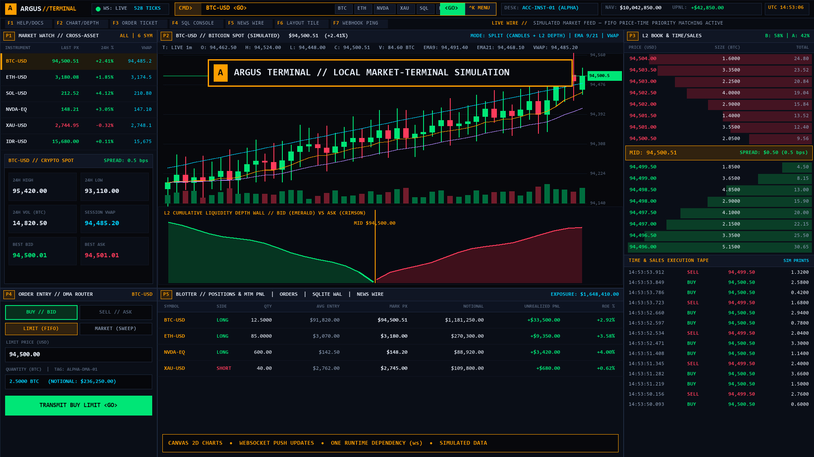

# Argus Terminal

**Educational, local-first simulation of a multi-pane trading, quantitative risk, derivatives, and macro fixed-income workstation built with Node.js, built-in `node:sqlite`, WebSockets, and zero-build HTML5 Canvas.**



> **Disclaimer**: All market prices, order flow, venues, news items, and accounts in this repository are **100% synthetic and simulated locally**. Nothing connects to any live exchange, broker, or market data vendor. Built as a software engineering and quantitative systems architecture portfolio project.

---

## What Is Inside

Argus Terminal runs as a single local Node.js process (`127.0.0.1:3400`) with only **one external npm runtime dependency (`ws`)** and Node's built-in `node:sqlite` (`DatabaseSync`). No frontend bundler or build step is required.

### Four Interactive Browser Workstations

| Route | Command Bar Shortcut | Focus Area |
| :--- | :--- | :--- |
| **`/`** (`public/index.html`) | `BTC-USD <GO>`, `DEPTH <GO>`, `QUANT <GO>`, `SQL <GO>` | **Main Multi-Pane Trading Terminal**: `<GO>` command autocomplete, 6 simulated cross-asset tickers, price-time FIFO L2/L3 order book & depth chart, OHLCV candlesticks (`EMA 9/21`, `VWAP`), DMA order ticket, positions/orders/fills blotter, read-only SQLite console, and live news wire. |
| **`/options.html`** (`public/options.html`) | `OPT <GO>`, `FIX <GO>`, `ARB <GO>` | **Derivatives, Wire Protocols & Smart Order Routing**: Interactive 3D Gatheral SVI volatility surface, Black-Scholes-Merton 1st/2nd-order Greeks chain + hybrid Newton-Raphson/bisection IV solver, FIX 4.4 `tag=value` + 40-byte binary SBE wire inspector, and 4-venue Smart Order Router / spatial & triangular arbitrage scanner. |
| **`/macro.html`** (`public/macro.html`) | `YIELD <GO>`, `BOND <GO>`, `REPLAY <GO>`, `DARK <GO>` | **Macro Rates, Fixed Income, LOB Replay & Dark Pool**: Nelson-Siegel-Svensson (NSS) yield curve fitting (`1M`–`30Y`), bond dirty/clean pricing (`YTM`, `DV01`, Macaulay/Modified duration, convexity, `Z-spread`), deterministic LOB keyframe+delta replay scrubber with `SHA-256` state verification, and a simulated midpoint-peg dark pool (`ARGUS-DARK-ATS`) with VPIN toxicity gating. |
| **`/deck.html`** (`public/deck.html`) | `DECK <GO>` | **10-Slide Interactive Architecture Deck**: Keyboard-navigable HTML/Chart.js engineering walkthrough covering the matching engine, quantitative models, security hardening, and benchmark results. |

---

## Engineering Architecture (`src/`)

- **`src/engine/orderbook.js`** — Server-side price-time priority (FIFO) `Orderbook` and `MatchingEngine` with synchronous SQLite transaction persistence (`orders`, `trades`, `positions`, `accounts`, `audit_logs`) and a `5x` buying-power pre-trade risk gate.
- **`src/engine/slabOrderbook.js`** — Preallocated Struct-of-Arrays (`TypedArray`) arena order book (`capacity = 262,144`) with an intrusive doubly-linked list, `O(1)` slot cancellation via `idToSlot`, and an inspectable hand-assembled WebAssembly helper module (`WASM_BYTES`). Used for `/api/slab-metrics` and the 5-mode ablation benchmark (`benchmarks/matching_bench.js`).
- **`src/engine/quantRisk.js` & `src/engine/algoEngine.js`** — Correlated Cholesky Monte Carlo VaR/CVaR (`95%` / `99%`), Order Book Imbalance (`OBI`), VPIN-style order-flow toxicity proxy, Stoikov micro-price, Kelly sizing, OHLCV strategy backtester, and simulated `TWAP`, `VWAP`, `ICEBERG`, and `Avellaneda-Stoikov` execution schedules.
- **`src/engine/optionsGreeks.js`** — Analytical Black-Scholes-Merton pricing, 1st/2nd-order Greeks ($\Delta, \Gamma, \Theta, \mathcal{V}, \rho$, Vanna, Volga, Charm), verified Put-Call parity ($< 10^{-8}$ error), hybrid Newton-Raphson + bisection Implied Volatility solver, and 5-tenor SVI volatility surface generator.
- **`src/engine/fixProtocol.js` & `src/engine/smartOrderRouter.js`** — FIX 4.4 parser/builder with `Tag 9` (`BodyLength`) and Modulo-256 `Tag 10` (`CheckSum`) validation, 40-byte fixed-layout Little-Endian binary SBE codec, and multi-venue liquidity sweep / arbitrage scanner.
- **`src/engine/yieldCurveFixedIncome.js`, `src/engine/lobTimeMachine.js`, `src/engine/darkPoolEngine.js`** — Nelson-Siegel-Svensson yield curve model & bond analytics solver, event-sourced LOB replay engine with `SHA-256` book-hash verification, and midpoint-peg dark pool crossing engine.

---

## Quick Start

**Requirements**: Node.js `>= 22.13.0` (uses built-in `node:sqlite`). Tested on Node.js `v24.20.0`.

```bash
# 1. Install the single runtime dependency (ws)
npm install

# 2. Start the local server on http://127.0.0.1:3400
npm start
```

Open in your browser:
- Main Terminal: `http://localhost:3400/`
- Options, FIX/SBE & SOR Workstation: `http://localhost:3400/options.html`
- Macro Yield Curve, Bond Desk, LOB Replay & Dark Pool: `http://localhost:3400/macro.html`
- 10-Slide Architecture Deck: `http://localhost:3400/deck.html`

---

## Verification & Test Suites (`64 / 64` Passing Assertions)

All six verification suites run using plain Node.js with zero external test frameworks:

```bash
# Run all 6 test suites sequentially (64/64 assertions)
npm test
```

Or run individual suites:

| Command | Suite | Assertions | What It Verifies |
| :--- | :--- | :---: | :--- |
| `npm run test:e2e` | `tests/e2e.test.js` | `13 / 13` | Server boot, SQLite seeding, FIFO price-time matching, partial fills, buying-power rejection, order cancel, WebSocket broadcast. |
| `npm run test:security` | `tests/security_pentest_poc.js` | `5 / 5` | SQL injection blocking, SQL console `accounts`/`api_secret` table lockdown, `ACC-VAULT-99` IDOR header enforcement, SSRF loopback/private-IP blocking, negative/NaN order size rejection. |
| `npm run test:devtools` | `tests/devtools_audit.test.js` | `8 / 8` | Layout invariants, zero console/page errors, keyboard shortcuts, and API contract checks. |
| `npm run test:wave2` | `tests/wave2_quant.test.js` | `12 / 12` | `SlabOrderbook` FIFO & `O(1)` cancel, Monte Carlo VaR/CVaR invariants (`CVaR_99 >= VaR_99 >= VaR_95`), VPIN/OBI bounds, TWAP/VWAP/Iceberg/Avellaneda-Stoikov algos, backtester, and `/deck.html`. |
| `npm run test:wave3` | `tests/wave3_derivatives_fix.test.js` | `13 / 13` | BSM Put-Call parity ($< 10^{-8}$), IV solver round-trip ($< 10^{-4}$), SVI surface, FIX 4.4 checksum & tamper rejection, 40-byte SBE binary round-trip, Smart Order Router VWAP & arbitrage scanner. |
| `npm run test:wave4` | `tests/wave4_macro_replay_darkpool.test.js` | `13 / 13` | NSS yield curves (`NORMAL_STEEP`, `INVERTED_HAWKISH`, `FLAT_STAGFLATION`), bond YTM/duration/DV01/convexity/Z-spread, LOB Time-Machine `SHA-256` replay parity, and Dark Pool midpoint crossing + VPIN toxicity block. |

---

## Matching Engine Benchmark (`npm run bench`)

`benchmarks/matching_bench.js` runs an honest 5-mode ablation study across `250,000` deterministic limit-order operations (`seed = 20261024`, `187,880` fills, `10,496` cancels):

- **`orderbook-sqlite`** (`Orderbook` + in-memory SQLite transaction per fill): ~`10,006 ops/sec` (`24,984 ms` median)
- **`orderbook-memory`** (`Orderbook` in memory with V8 object arrays + `crypto.randomBytes`): ~`25,859 ops/sec` (`9,668 ms` median)
- **`orderbook-cheap-ids`** (`Orderbook` in memory without `crypto.randomBytes`): ~`38,015 ops/sec` (`6,576 ms` median)
- **`slab-js-kernel`** (`SlabOrderbook` preallocated `TypedArray` arena + plain JS helpers): ~`3,255,450 ops/sec` (`76.8 ms` median)
- **`slab-wasm`** (`SlabOrderbook` preallocated `TypedArray` arena + 3 WASM helper calls): ~`2,831,629 ops/sec` (`88.3 ms` median, `109.5x` faster than `orderbook-memory`)

See [`BENCHMARK_REPORT.md`](BENCHMARK_REPORT.md) and [`benchmarks/results/latest.json`](benchmarks/results/latest.json) for full methodology and why the `TypedArray` arena layout — rather than the 3-instruction WASM boundary — drives the ~`100x` speedup.

---

## Documentation & Reports

- [`ARCHITECTURE.md`](ARCHITECTURE.md) — System architecture, REST/WebSocket contracts, and module map
- [`BENCHMARK_REPORT.md`](BENCHMARK_REPORT.md) — 5-mode matching engine ablation study (`250,000` operations)
- [`SECURITY_AUDIT_REPORT.md`](SECURITY_AUDIT_REPORT.md) — 5-vulnerability white-box security audit and regression test verification
- [`DEVTOOLS_AUDIT_REPORT.md`](DEVTOOLS_AUDIT_REPORT.md) — UI layout, accessibility, and canvas rendering audit
- [`GRAPH_REPORT.md`](GRAPH_REPORT.md) — Knowledge graph structural analysis (`graphify-out/`)
- [`research/INDEX.md`](research/INDEX.md) — Background quantitative notes vs. implemented code comparison

---

## License

Released under the [MIT License](LICENSE). Copyright (c) 2026 Ardhya Novri Ramadhan.
